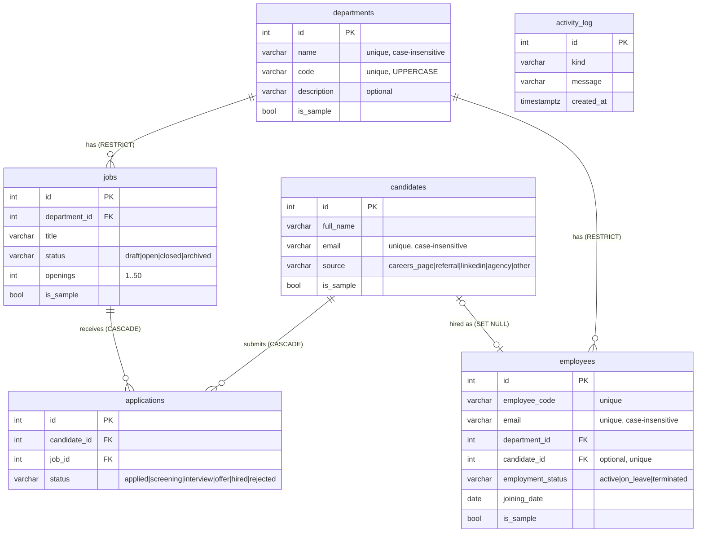
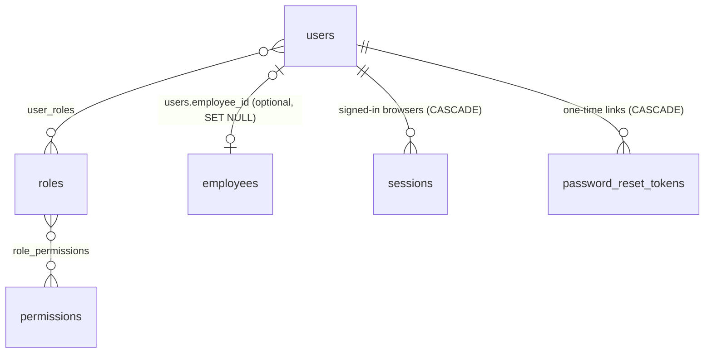

# WorkforceOS database architecture (Phase 2, extended in Phases 3–4)

PostgreSQL holds everything. The tables are defined in `backend/app/models.py` and created/changed only by the Alembic
migrations in `backend/migrations/versions/` (never by hand, never by `create_all()` outside the tests).

## Entity-relationship diagram

(GitHub and VS Code with a Mermaid extension draw this as a diagram. Every table also has `created_at`, and the editable ones `updated_at`, stored as UTC.)

## Tables

| Table | What a row is | Key rules enforced by PostgreSQL |
|---|---|---|
| `departments` | A team, e.g. Engineering (ENG) | `name` unique ignoring case (`uq_departments_name_lower`), `code` unique and upper-case |
| `jobs` | A role you are hiring for | `department_id` must exist; `openings` 1–50; `status`/`employment_type` from a fixed list |
| `candidates` | A person in your talent pool | `email` unique ignoring case |
| `applications` | A candidate applying to a job | one per (candidate, job) (`uq_applications_candidate_job`); valid status |
| `employees` | A person who works here | `employee_code` unique; `email` unique ignoring case; `department_id` must exist; a candidate can become at most one employee |
| `activity_log` | One line of the dashboard's "Recent activity" | — |
| `alembic_version` | Which migration the database is at | managed by Alembic |

## What happens on delete (and why)

| You delete… | Effect | Why |
|---|---|---|
| a department that still has jobs or employees | **refused** (`ON DELETE RESTRICT`, API answers 409) | deleting a team must never silently delete people |
| an empty department | deleted | nothing depends on it |
| a job | its applications are deleted too (`CASCADE`) | an application without a job is meaningless; the UI warns first |
| a candidate | their applications are deleted (`CASCADE`); an employee record made from them **stays**, its `candidate_id` becomes NULL (`SET NULL`) | the employee still works here |
| an employee | only that row | to keep history, set the status to `terminated` instead |

## Business rules the API adds on top

* Applications move forward one stage at a time (applied → screening → interview → offer → hired) or to rejected.
* Only open jobs accept applications; a job can't hire more people than its openings. Hiring locks the job row
  (`SELECT … FOR UPDATE`) so two simultaneous "hire" clicks can't both take the last opening.
* Only a candidate with a **hired** application can be turned into an employee, and only once.

Every rule above is checked twice: the API checks first so it can show a friendly message on the right form field, and
the database constraint is the final guard (for example if two requests arrive at the same moment). If the database
refuses a change, the whole request is rolled back: nothing is half-saved.

## IDs

Tables use plain integers (`1`, `2`, …). The API shows them with a prefix so you can tell them apart:
`DEP-4001`, `JOB-1001`, `CAN-2001`, `APP-3001`, `EMP-5001` (prefix + offset + id). The conversion lives in `app/ids.py`.
Employee *codes* (`E-0001`) are a separate, human-chosen business identifier.

## Sample data

`python -m app.seed` inserts sample records with `is_sample = true` (shown as a "Sample" tag in the website).
It only adds what is missing, so running it twice creates no duplicates. `python -m app.seed --remove-sample` deletes
sample records but never your own, and keeps sample departments/jobs/candidates your own records still depend on.

## Migrations so far

| Revision | What it does |
|---|---|
| `0001` | jobs, candidates, applications, activity_log |
| `0002` | **data migration**: creates `departments` from the distinct text values in `jobs.department` ("sales" and "Sales" become one; blank becomes "Unassigned"), points every job at its department, then drops the old text column |
| `0003` | employees |
| `0004` | `is_sample` flags; recognises the original sample jobs/candidates by title/e-mail |
| `0005` | accounts: users, roles, permissions, sessions, reset links, auth attempts + the built-in roles and their permissions (data) |
| `0006` | security: `audit_events` (append-only, triggers refuse UPDATE/DELETE/TRUNCATE on PostgreSQL), `audit:read` permission for Super Administrator, `sessions.reauthenticated_at` |

## Accounts and access control (Phase 3, migration `0005`)

| Table | What a row is | Key rules |
|---|---|---|
| `users` | an account that can sign in | e-mail unique ignoring case; `password_hash` = Argon2id (NULL = invited, no password yet); status `active`/`disabled`; optional unique `employee_id` |
| `roles` | a named bundle of permissions | unique `name`; `is_system` for the 5 built-in roles |
| `permissions` | one right, e.g. `employees:update` | unique `code`; the list is defined in `app/auth/permissions.py` |
| `user_roles`, `role_permissions` | the many-to-many links | deleting a role still assigned to a user is refused (RESTRICT) |
| `sessions` | a signed-in browser | stores only `sha256(token)`, the CSRF token, absolute and idle expiry |
| `password_reset_tokens` | a reset or invitation link | hashed, single use (`used_at`), `expires_at` |
| `auth_attempts` | each sign-in/sign-up/reset attempt | used for rate limiting; rows older than a day are removed |

Accounts and employee records stay separate: an employee may have no account, and an account may have no employee
record. Deleting an employee unlinks the account (`SET NULL`); deleting an account is not offered (disable it instead).
"Reset demo data" only touches business tables, never accounts. Details: [AUTH.md](AUTH.md).

## Audit log and database security (Phase 4, migration `0006`)

| Table | What a row is | Key rules |
|---|---|---|
| `audit_events` | one security-relevant event: who, what, target, outcome, when, from where | append-only (database triggers); `hash` = HMAC of the row + `prev_hash` (a chain); `key_id` says which key signed it; `details` (JSONB) never holds passwords, tokens or personal values |

`audit_events` deliberately has **no foreign keys**: a record must survive the deletion of the user or record it
mentions, so it stores the public ID and e-mail as they were. It is separate from `activity_log` (the friendly
dashboard feed, which "Reset demo data" clears) and is never touched by the reset.

Since Phase 4 the app can run as a **restricted database user** (`workforceos_app`: data only, append-only audit,
read-only permission list), while migrations run as the owner via `MIGRATION_DATABASE_URL`. Every app connection has
`statement_timeout = 15 s`. Setup, backups and restore: [SECURITY.md §8–9](SECURITY.md#8-least-privilege-database-access).
